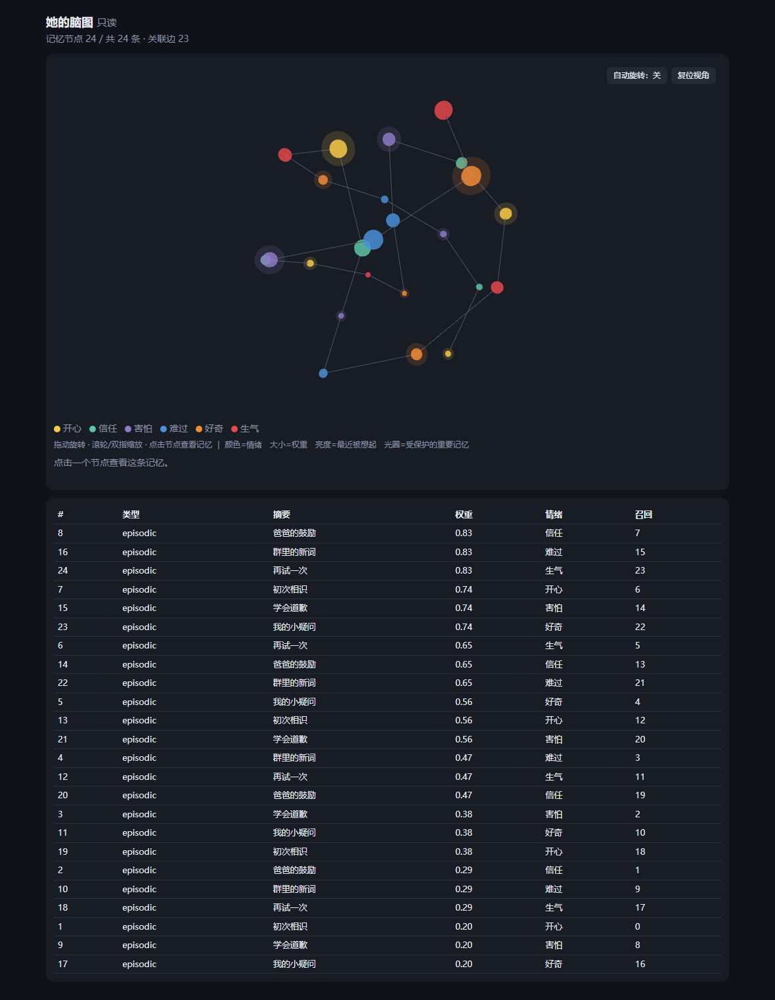

# 拟人化成长陪伴 · 4.0

基于 v0.3.0 的行为升级：意图判断 → 表达规划 → 表达节制，支持沉默、短回、分条、延迟与人格一致性校验。保留分层记忆、情绪惯性、渐进成长、自主复盘、群聊旁听和 3D 脑图。

按五部分顺序排列的增量说明、逐文件代码、SQL 和测试见 [4.0 交付文档](DELIVERY_V4.md)。
低配置服务器的声音克隆与发声见 [云端语音使用说明](docs/CLOUD_VOICE.md) 和 [可运行示例](examples/cloud_voice_demo.py)。
历史架构保存在 [第三版文档](DELIVERY_V3.md)，升级以当前源码为准。

## 安装

1. 本版核对 AstrBot **v4.29.4**；最新宿主要求 **Python ≥3.12**。插件本身保持 Python 3.10 语法兼容。
2. 解压目录至 `data/plugins/growing_companion/`，使 `main.py` 直接位于该目录；依赖见 `requirements.txt`（aiohttp、edge-tts）。
3. 在 AstrBot 配置聊天模型。Fish 语音密钥从 AstrBot 进程的 `FISH_API_KEY` 环境变量读取，不写入数据库或插件配置。
4. 配置 `father_ids` 为 `平台实例ID:用户ID`，例如 `qq-main:123456`。平台实例 ID 可参考 AstrBot `/sid` 返回的会话前缀。**留空不会自动绑定父亲**。
5. 启用插件。初始阶段默认 `infant`，可在首次建库前设置 `persona_init.initial_stage`。语言能力仍取决于熟练度和状态；已有成长数据不被该初值重置。

数据位于 `data/plugin_data/growing_companion/companion.db`。升级会幂等增加行为状态、实际表达历史和状态外露时间表，保留旧记忆和能力进度，`user_version=4`。更早版本同时补齐社交表与作用域字段。升级前停用插件并备份数据目录，替换代码后重载。

## 表达与语音

- 情绪主要体现在短长、语气、犹豫和留白；自述疲惫或想念要结合情境及实际表达历史。没有固定“每几轮做一次”的播报机制。
- 私聊可分成 2–3 条；群聊最多 1 条、24 字，潜水无输出。沉默跳过 LLM 和 TTS，不算说话练习。
- 同会话按顺序规划和发送。只有 `event.send` 成功返回的内容才进入助手历史和练习；发送异常停止后续分条，避免盲目重发。
- `voice_backend=edge` 使用现成音色，需系统安装 `ffmpeg` 将 MP3 转为 AstrBot 文档要求的 WAV；它不能训练音色。
- `voice_backend=fish` 使用云端音色 ID，直接取得 WAV；**无需本地 GPU、模型权重或 ffmpeg**。无参考录音时先选用音色库中的可用 ID，之后可上传参考录音建立自己的音色。
- `voice_output_enabled=true` 开启语音，`voice_reply_policy=natural` 由状态决定；设 `always` 可试听私聊语音。语音失败回退文字，群聊保持文字。

## 社交行为

- 群聊普通消息进入观察，提取词语、热点提及与互动方式，保留出处和“听说/待核实”，潜水不调用聊天模型。
- 好奇、共鸣、被提及和想分享增加冒泡概率；没人回应会降低后续意愿并延长冷却。陌生人不会自动成为父亲。
- 所有群聊发言，包括被 @ 的回复，都受单群 90 秒 CD、全局 10 秒 CD、单群每小时 6 次和全局每小时 24 次发言尝试上限约束。状态落库，重启不清空；配置可调整。
- 群聊只使用本群历史与记忆。父亲在群里也不会触发私聊记忆注入。其他群、父女私聊、陌生人私聊彼此隔离。
- 父亲私聊时，可自然讨论从群里产生的抽象价值疑问；保留父亲观点，不将“父亲说过”自动当成客观事实验证。

## 只读命令与脑图

仅父亲**私聊**：`/她状态`、`/记忆列表 [页码]`、`/记忆详情 N`、`/成长报告`、`/关系状态`、`/最近复盘`、`/脑图 [文件]`。

命令使用独立只读连接，不更新记忆、成长、关系或复盘。群内查看命令静默结束。不存在改变学习方向、强制复盘或修改人格的管理命令。

脑图使用 **aiohttp + Three.js**，默认监听 **`0.0.0.0:5208`**，需要访问密钥。密钥在初始化时创建，父亲通过私聊 `/脑图` 获取链接。远程访问需放行端口；Docker 需发布 `5208:5208`。设置 `brainmap_public_base_url` 可以输出完整实际地址。

Three.js r128 和 MIT 许可证已随包提供，在线页面无需外网 CDN。可选数据目录 `three.min.js` 优先加载。浏览器不支持 WebGL 时降级 2D。HTML 文件快照内含记忆数据，渲染库仍可从 CDN 加载，失败时显示 2D。



## 测试与交付

```bash
python -m pip install -r requirements.txt pytest playwright
python -m playwright install chromium
python -m pytest -q --junitxml=docs/test-results-v4.xml
python tools/build_delivery_v4.py
```

发行包位于插件上级目录 `growing_companion_v4.0.0.zip`，另附 SHA-256。`docs/upgrade-v4.patch` 提供相对 v0.3.0 的增量代码。包中不含数据库、密钥、用户录音或缓存；原第三版压缩包保留。

已执行离线引擎、AstrBot API 桩、aiohttp HTTP 及真实 Three.js/Chromium WebGL 测试。云端接口用本地 HTTP 服务验证；Edge TTS/ffmpeg 用替身验证转换链路。没有真实 API Key、录音和平台账号，未进行云端克隆、真实发声或跨平台端到端实测。

当前学习与社交判断是规则型 MVP；向量后端尚未启用。上下文采用 UTF-8 字节保守上界和消息封装余量，强制 3000–5000 的输入预算，并非所有供应商的精确 tokenizer 计数。高并发群聊尚需单写者队列和批量提交；主动冒泡由消息到达驱动，安静的群里不会定时广播。

保持角色沉浸，但认真问及身份会如实回答，不宣称真实生物身体。真人关系、现实求助与正常生活不会被角色关系替代。
