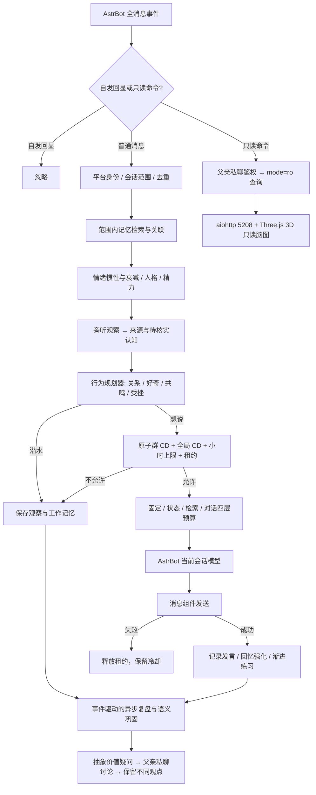

# 拟人化成长陪伴插件 · 第三版（v0.3.0）

本版基于工作目录原有 v0.1.3 实现升级。交付的是可安装的 AstrBot 插件源码，不是只有接口的示意工程。原有记忆、情绪、成长、人格、内在生活、语音适配和只读页面保留；本版新增社交观察、多人关系、会话隔离、持久化发言限流和父亲引导价值讨论。正文严格按需求的九部分组织。

## 1. 需要确认的 AstrBot API 点（已核对 5 项）

核对日期：2026-11-10。官方 latest 指向 [v4.29.4](https://github.com/AstrBotDevs/AstrBot/releases/tag/v4.29.4)。以下是源码/文档核对结果；真实平台的消息权限和投递范围仍需部署环境验证。

| API 点 | 本版采用方式与核对结果 |
|---|---|
| ① 群聊未唤醒消息监听 | `@filter.event_message_type(filter.EventMessageType.ALL)`。类型过滤不要求 @；唤醒阶段匹配插件过滤器后会让事件进入插件，但不会把 `is_at_or_wake_command` 设为真。观察分支不 `yield`、不 `send`，也不调用聊天模型。只能读到平台实际投递且通过框架访问控制的消息，无法绕过平台权限读取历史。见 [类型过滤源码](https://github.com/AstrBotDevs/AstrBot/blob/v4.29.4/astrbot/core/star/filter/event_message_type.py)、[唤醒阶段](https://github.com/AstrBotDevs/AstrBot/blob/v4.29.4/astrbot/core/pipeline/waking_check/stage.py)。 |
| ② 自主发送与阻止默认重复回答 | 当前事件用 `event.chain_result([Comp.Plain(text)])` + `await event.send(...)`。主动冒泡仍是对到达消息的自主决策，不是定时广播。被明确叫到但正在 CD 中时 `event.stop_event()`，阻止默认 LLM 绕过插件冷却；普通潜水不终止其他插件。`is_wake` 不能当成“有人叫她”。见 [事件源码](https://github.com/AstrBotDevs/AstrBot/blob/v4.29.4/astrbot/core/platform/astr_message_event.py)、[默认 LLM 分支](https://github.com/AstrBotDevs/AstrBot/blob/v4.29.4/astrbot/core/pipeline/process_stage/stage.py)。 |
| ③ 模型调用与上下文 | `await context.get_current_chat_provider_id(umo=...)`，再 `await context.llm_generate(chat_provider_id=..., prompt=..., system_prompt=..., contexts=...)`。不自己读取 API Key，不调用默认 LLM 后再二次追答。见 [官方 AI 文档](https://docs.astrbot.app/dev/star/guides/ai.html)、[Context 源码](https://github.com/AstrBotDevs/AstrBot/blob/v4.29.4/astrbot/core/star/context.py)。 |
| ④ 注册、生命周期、数据目录 | `Star`、`@register`、`@filter.command`，异步 `initialize/terminate`；`StarTools.get_data_dir('growing_companion')` 定位持久化目录。初始化建表/生成密钥，查看命令不懒初始化。见 [StarTools](https://github.com/AstrBotDevs/AstrBot/blob/v4.29.4/astrbot/core/star/star_tools.py)、[消息开发文档](https://docs.astrbot.app/dev/star/guides/listen-message-event.html)。 |
| ⑤ 身份、会话与 Python 版本 | 使用 `event.platform_meta.id + ':' + event.get_sender_id()` 标识人，`event.unified_msg_origin` 标识群/私聊会话。父亲须显式配置；相同用户号在不同平台实例不混同。插件语法兼容 Python 3.10；**AstrBot v4.29.4 自身要求 Python ≥3.12**，部署必须跟随宿主要求。见 [宿主 pyproject](https://github.com/AstrBotDevs/AstrBot/blob/v4.29.4/pyproject.toml)。 |

`@register` 按需求保留。代码固定核对 v4.29.4，元数据声明 `>=4.29.4,<5`；这不是对未来所有小版本的实测承诺。接入其他版本时优先复核上述五处。

发送时序：`yield event.plain_result(...)` 的分支必须在生成器恢复后再 `event.stop_event()`，不能提前停止或 yield 已停止的结果；[v4.29.4 调度器](https://github.com/AstrBotDevs/AstrBot/blob/v4.29.4/astrbot/core/pipeline/scheduler.py) 在每个 yield 后会先检查停止标志。`await event.send(...)` 则直接执行发送。回归测试专门覆盖这一顺序。

## 2. 整体架构图和模块职责



| 模块 | 职责 |
|---|---|
| `main.py` | 唯一 AstrBot 入口；身份与命令分流、消息组件、生命周期、发送结果确认。 |
| `engine.py` | 协调状态、记忆、预算、模型和复盘；父亲私聊保留原有亲密陪伴链路。 |
| `social.py` | 群聊旁听、社会认知、熟悉度、发言租约、回应反馈、跨群限流和价值问题讨论。群聊中即使是父亲也只检索当前群记忆。 |
| `memory.py` | 分层记忆、权重衰减、情绪加权、强化、主动浮现、关联扩散、认知重构与压缩；原文不改。 |
| `emotion.py / persona.py` | 六维情绪、惯性、嘴硬心软、后悔；人格缓慢变化、偏好、注意力和虚构精力节律。 |
| `growth.py` | `infant → child → teen → young_adult`；阶段时间、熟练度、见识、练习、认知和前置能力共同决定解锁。久不练会生疏，状态差时表现暂时退行。 |
| `cognition.py / planner.py` | 判断不懂、价值冲突和是否回应；把状态转成概率与表达倾向，不强求永远顺从。 |
| `reflection.py / inner_life.py / life_tick.py` | 私聊自主复盘、语义巩固、愿望和承诺等状态；维护节拍只更新时间流逝，复盘和发言不按固定频率执行。 |
| `budget.py / prompts.py / llm.py` | 四层上下文、优先级裁剪、AstrBot 模型适配与超时。 |
| `db.py / readonly_views.py / brainmap/` | SQLite 增量迁移、强制只读查询、鉴权 Web 服务与真实 3D 渲染。 |

行为的“自然”来自连续状态、历史反馈与概率，而不是随机装可爱。父亲身份和平台发言限制属于明确约束；情绪、学习与复盘属于自主倾向。她不需要永远回复，也不会用“你不理我就是不爱我”要求陪伴。被认真问及现实身份时会如实说明；角色里的动作和精力不宣称真实生物身体。

社交概率的 MVP 近似为：`p = (0.04 + 0.4×动机 + 0.08×新鲜度) × 精力 × 外向倾向 × (1 − 0.85×受挫)`，再乘关系系数并限制上界。动机取兴趣×好奇、共鸣、想分享、被提及中的强项。明确呼唤可以提高回应意愿，但仍必须取得发言名额。没有回应时受挫累积；明确回应、时间恢复会使其下降。

## 3. 插件目录结构

```text
growing_companion/
├── main.py
├── metadata.yaml
├── _conf_schema.json
├── requirements.txt
├── README.md
├── DELIVERY_V3.md                # 本文，包含逐文件完整源码
├── core/
│   ├── db.py / models.py
│   ├── engine.py / social.py
│   ├── memory.py / emotion.py / growth.py
│   ├── cognition.py / planner.py / persona.py / relationship.py
│   ├── inner_life.py / reflection.py / life_tick.py
│   ├── budget.py / prompts.py / perception.py / clock.py
│   ├── llm.py / speech.py / readonly_views.py
│   └── brainmap/
│       ├── server.py / export.py / page.py
│       └── vendor/three.min.js / THREE-LICENSE.txt
├── tests/                       # 既有回归 + 社交、入口和真实 WebGL 测试
├── docs/schema_v3.sql
├── docs/brainmap-preview.png     # 合成演示数据，非用户真实记忆
└── tools/build_delivery.py       # 生成源码文档、完整 SQL、发行包与校验值
```

运行数据存放在 `data/plugin_data/growing_companion/companion.db`，不放进插件代码目录。升级替换源码不会覆盖该数据库。新库和旧版库均自动迁移到 `PRAGMA user_version=3`，原表与原始文本保留。

## 4. metadata.yaml 和 _conf_schema.json 示例

下面直接给出本次发行的实际文件，不使用伪配置。

{{CONFIG}}

关键默认值：脑图 `0.0.0.0:5208`；每群 CD 90 秒，全局群聊间隔 10 秒；单群每小时 6 次、全部群每小时 24 次发言尝试。模型失败和发送失败也消耗本轮名额，避免失败循环刷屏。`social_cooldown_seconds` 最低 10 秒，全局间隔最低 3 秒；受挫会进一步延长每群 CD。CD 不承诺消除所有平台风控风险。

安装：将目录解压至 AstrBot 的 `data/plugins/growing_companion/`，确认 `main.py` 没有多套一层；宿主使用 Python ≥3.12，并配置聊天供应商；在插件后台填写 `father_ids` 为 `平台实例ID:用户ID`，例如 `qq-main:123456`。实例前缀可参照 AstrBot `/sid` 的会话来源，用户 ID 以平台发送者标识为准。留空保持未绑定，不采用“第一个私聊者认领”的旧行为。

初始阶段默认 `infant`，真的会限制为短词/咿呀；希望立即验证完整聊天，可在首次创建数据库前设 `persona_init.initial_stage=child`。已存在的成长记录不会因为改此初值被重置。没有限制学习方向、清空人格或强制复盘的管理命令。

启动后，父亲私聊 `/脑图` 获得带访问密钥的链接。远程服务器需要放行该端口；Docker 还需 `5208:5208` 端口映射。设置 `brainmap_public_base_url` 可生成实际公网链接。浏览器先使用随包的 Three.js r128，数据目录同名脚本可覆盖；后备 CDN 和 2D 降级仍保留。随包脚本来自 [Three.js 官方 r128](https://github.com/mrdoob/three.js/tree/r128)，MIT 许可证随包提供。

## 5. 核心数据模型和 SQLite 表结构

| 核心模型/表 | 含义与约束 |
|---|---|
| `Percept / EmotionSnapshot / GrowthProfile / BehaviorPlan / SocialDecision / EngineReply` | 感知、情绪、当前能力、行为计划、社交决定和待确认发送结果。均有类型注解；`speech_token` 是发言租约，不是身份认证。 |
| `conversation_log` | 工作记忆与原始对话日志；社交行按 `scope_id` 隔离，同群上下文标记发言者。 |
| `memories / memory_links / memory_revisions` | 情景、语义、情绪、关系记忆；原文 `content` 不覆盖，可改理解 `gist` 并留修订。关联扩散、压缩父节点和候选检索均校验范围。 |
| `scope_id / source_kind / confidence / source_ids_json` | 来源范围、经历/听说/复盘/父亲观点、置信度及证据链。旧数据归入 `legacy:father` 私域；不注入群聊。 |
| `relationships / relationship_events` | 延续原有父亲依恋、信任、冲突和关系经历。 |
| **`social_relationships`** | `actor_id`、角色、熟悉度、信任、交流/观察次数、初见/上次交流时间。旁听不直接增加信任；熟人需要交流和时间。 |
| **`social_cognition`** | 社会认知、词语、热点提及、互动方式与价值疑问。存出处及原始记忆 ID。听说默认置信度 0.3；重复流传只增加出现次数，不当成验证。 |
| **`speech_cooldowns`** | 每个会话及全局的 `next_allowed_at / lease_token / lease_until / window_count / frustration / awaiting_ack`。短事务 `BEGIN IMMEDIATE` 原子检查并占位。发送成功才确认；进程重启仍保留 CD。 |
| `seen_messages` | 按会话+消息 ID 去重；仅去重索引保留七天，原始记忆不受影响。平台无消息 ID 时不冒称具备可靠去重。 |
| `growth_state / capability_defs / capabilities / milestones` | 阶段、能力条件、渐进熟练度、练习计数、退步次数和里程碑。 |
| `reflections / beliefs / preferences` | 自主复盘记录、可修正信念、经历形成的偏好。社交复盘留在来源范围，父亲引导另留私域观点。 |
| `wishes / dreams / secrets / promises` | 保留内在生活结构；MVP 对愿望、承诺和梦有基础记录，秘密自主形成与复杂兑现核验仍在迭代路线。 |
| `memory_embeddings` | 可选向量扩展结构：模型、维度、向量和原始记忆外键。MVP 实际使用 SQLite 词面+关联检索，此表不会假装已有向量服务。 |

完整 SQL 从实际迁移后的 SQLite 元数据导出，包含全部表和索引：

{{SQL}}

只读命令与 Web 请求使用独立的 `mode=ro + PRAGMA query_only=ON` 连接。不更新召回计数、不刷新权重、不绑定父亲、不创建密钥、不触发复盘。页面展示的衰减权重在内存纯计算。后台成长或其他正常消息可能同时写库，这不属于查看操作造成的写入；测试在无并发背景写入条件下验证整库指纹不变。

## 6. 插件主类与接口（Star、@register、@filter）

实际入口是 `GrowingCompanion(Star)`：

```python
@register("growing_companion", "Companion Contributors", "拟人化成长陪伴第三版", "0.3.0")
class GrowingCompanion(Star):
    # initialize: 启动 aiohttp、状态维护任务
    # terminate: 取消并回收任务，关闭 Web 和数据库
    @filter.event_message_type(filter.EventMessageType.ALL)
    async def on_message(self, event: AstrMessageEvent):
        # 完整实现见下一节 main.py；此处为入口索引。
        ...
```

以上仅展示接口索引；下面第 7 节提供完整实现，没有待填的业务函数。只读命令通过 `@filter.command` 注册，同时保留文字命令解析，兼容框架已剥掉唤醒前缀的情况。事件标记防止监听器与命令处理器重复执行。

| 命令 | 作用 |
|---|---|
| `/她状态` | 当前情绪、精力、注意力和成长状态 |
| `/记忆列表 [页码]` | 权重排序的记忆索引 |
| `/记忆详情 N` | 原文、理解、来源、置信度、关系边和修订历史 |
| `/成长报告` | 阶段、能力熟练度、练习次数及里程碑 |
| `/关系状态` | 父亲依恋、多人人际关系、受挫和 CD 状态 |
| `/最近复盘` | 最近一条私聊或社会观察复盘 |
| `/脑图 [文件]` | 只读 Web 链接，或含记忆数据的 HTML 快照；文件模式仍可能需要 CDN 加载 Three.js，失败可显示 2D |

所有面板只对父亲私聊提供。群内命令静默结束，避免群里泄露脑图密钥或私密记忆。父亲在群聊的一般对话仍可以亲近，但不取用父女私聊历史。

## 7. 最小可运行 MVP 代码（逐文件完整给出）

这部分就是发行包实际源码。核心逻辑可脱离 AstrBot 测试；`main.py` 接通框架。协议中的 `...` 用于类型声明，空 `__init__.py` 仅作包标识；业务方法均已实现。`NullSTT/NullTTS` 明确表示未配置语音时返回 `None` 的降级实现。

{{SOURCE}}

MVP 的实现边界：

- 群聊潜水不调用模型，使用规则提取引号词语、定义句、热点提及和礼貌互动；复杂讽刺、转述、指代与真假新闻判断尚不可靠。因此保留“听说/待核实”及来源，不能称为事实核验系统。
- 主动冒泡由到达的新消息触发规划，完全无消息时不会自行向群里广播。被冷落的超时反馈在下一次消息到达时惰性结算；不会有后台任务向群里追问“为什么不理我”。
- 复盘按新鲜感、情绪、未解决问题和认知冲突决定。社会观察采用规则型语义压缩；父亲私聊可调用模型进行深度复盘。后台任务有并发上限，卸载会回收。
- 默认每个引擎的状态更新串行；SQLite 小数据短操作同步执行，Web 读图放到工作线程。大群高并发需在下一版引入单写入队列/批量提交和有界消息队列，不能宣称本版已做吞吐压测。
- 总输入上下文配置强制 3000–5000，采用 UTF-8 字节保守估算并计入标题、消息封装余量。适用于常见字节分词器，**不是所有供应商 tokenizer 的精确 token 计数**；自定义供应商需接入专用计数器。输出 token 不包含在此输入预算内。
- 语义检索当前是词面二元组、标签、情绪权重和关系边扩散；向量表已经保留，向量后端尚未启用。
- `event.send` 正常返回作为本地发送成功依据，平台是否实际向终端投递仍由适配器保证。限流按发言尝试计数，重启和异常都不清空额度。
- 真实平台接入、真实供应商输出与公网端口映射尚未在本环境实测；仓库提供的离线测试与真实浏览器 WebGL 测试并不替代部署验收。

## 8. 测试用例

{{RESULT}}

执行方式：在插件目录安装 `requirements.txt` 与开发依赖 `pytest playwright`，再按需 `python -m playwright install chromium`。运行：

```bash
python -m pytest -q
```

测试覆盖：原始记忆不被覆盖、压缩与关联召回、情绪惯性、成长不能只靠时间解锁、能力退步、四层预算及 Unicode、缓存、父亲身份、首次查看不写库、HTTP 鉴权与只读、端口冲突、旧版库迁移、潜水不调用 LLM、未唤醒冒泡、同群并发抢占、跨群全局 CD、小时上限、重启持久性、生成/发送失败不伪造发言、受冷落降低概率、熟人形成、跨范围检索/压缩隔离、价值观讨论、复盘任务上限、真实 Three.js WebGL 渲染。

测试源码如下。模型以可控桩替代，时钟和随机源可注入；真实 WebGL 测试读取随包 Three.js，无外网依赖。浏览器或 Node 未安装时对应浏览器/语法测试会显式跳过。

{{TESTS}}

建议部署验收：普通群友连续发送三条不相关消息，确认她主要潜水；@ 她触发一次回复，再次 @ 确认 CD 生效；重启后确认 CD 仍在；父亲私聊查看状态并打开脑图；在群里讨论一个未核实的新词，确认社会认知带“听说”与来源；确认另一群及父女私聊的具体内容没有出现在当前群模型输入。

## 9. 后续迭代路线

1. **v3.1 认知理解**：接入 AstrBot 的结构化判断供应商，识别真正的对话对象、引用、共鸣和反讽；对模型输出做枚举/范围/证据校验。保留当前规则降级路径，硬 CD 不交给模型决定。
2. **v3.2 记忆检索与事实更新**：可选 embedding 后端、作用域过滤与证据反向索引；带时间的事实版本、冲突观点和来源可靠性；压缩摘要经对照检验后才进入认知。每个供应商提供精确 tokenizer 适配。
3. **v3.3 更自然的关系成长**：长期兴趣迁移、跨情境但不泄密的泛化、完整承诺兑现、主动形成小秘密、逐步自我叙事；更细的关系修复，避免仅按对话次数判断亲疏。
4. **v3.4 高并发与部署**：有界消息队列、SQLite 单写者/批提交、反压、重放和适配器端到端测试；Web 增加只读增量刷新和检索筛选，不开放修改人格或强制学习的管理命令。

从 v0.1.3 升级的迁移要点：保留数据库路径；配置父亲 ID 时加平台实例前缀；旧的自动绑定键保留但不再授予权限；只读命令改为父亲私聊；依赖新增 aiohttp；原版归档 `growing_companion.zip` 不被覆盖，本版另给带版本号的安装包。
